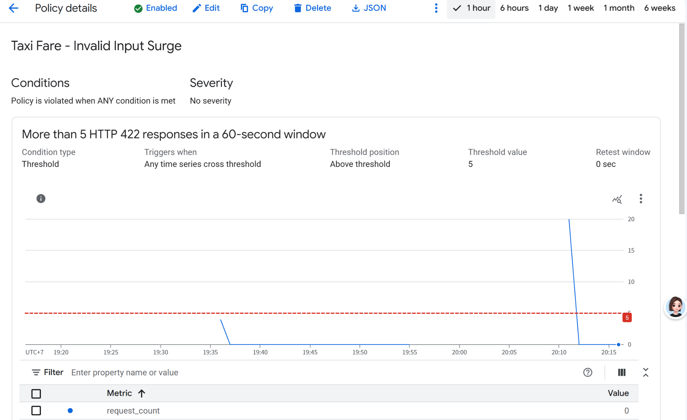
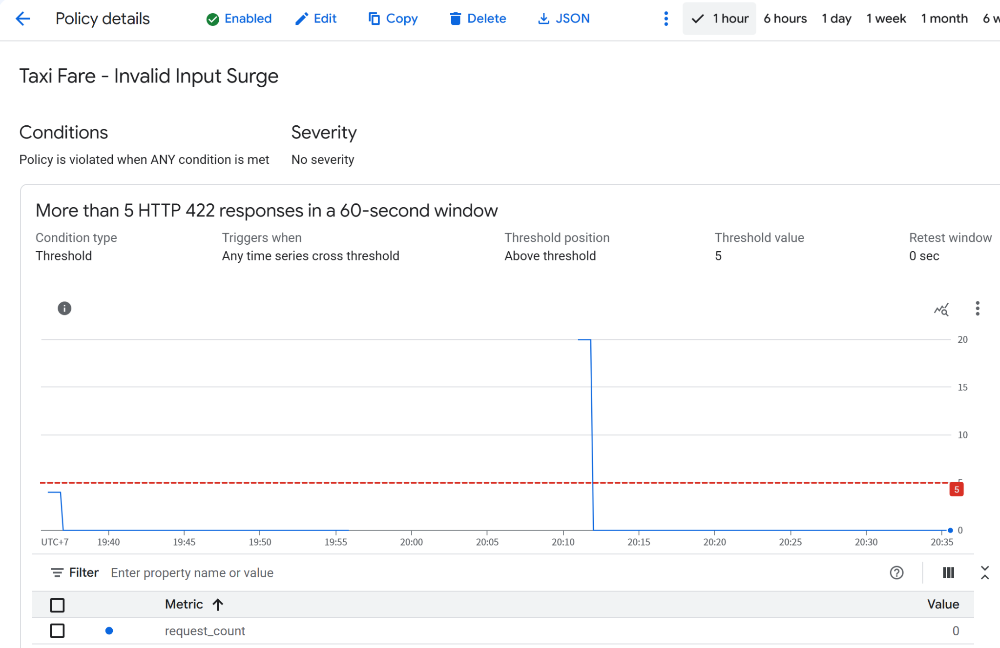
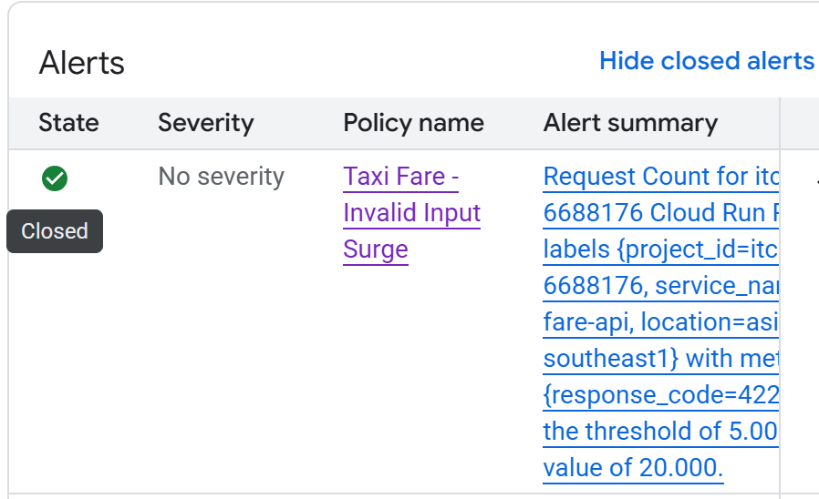

# Monitoring and Alert Evidence

Recovered original screenshots from the 9 October 2026 demonstration.
The images have been renamed for clarity; their contents have not been edited.

| Screenshot | What it shows |
|---|---|
| [Threshold exceeded](alert-threshold-exceeded.png) | Taxi Fare - Invalid Input Surge policy, threshold greater than 5 HTTP 422 responses per 60-second window, observed peak of 20. |
| [Count returned to zero](alert-count-returned-to-zero.png) | The same policy graph later shows the observed request count returning to zero. This graph alone does not prove incident closure. |
| [Incident closed](incident-closed.png) | The alert list explicitly displays Closed for the Taxi Fare - Invalid Input Surge incident; its summary includes response_code=422, threshold 5 and value 20. |
| [Requests and latency](dashboard-requests-latency.png) | An earlier dashboard window showing request rate and latency by response-code series. |
| [Error rates](dashboard-error-rates.png) | An earlier dashboard window showing 4xx responses. The 5xx panel has no data; this does not establish zero errors. |

The dashboard screenshots show an earlier test window than the 20-request alert burst. They should not be presented as screenshots of that same burst.

Email notification was reported as received during the demonstration and is described in ../../failure-demo.md. No email screenshot was recovered in this package. The screenshots above must not be described as proof of mailbox delivery.

